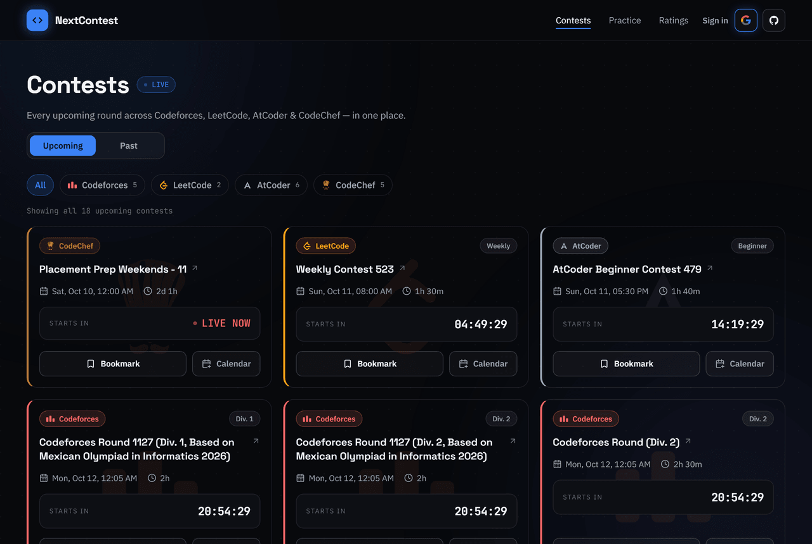
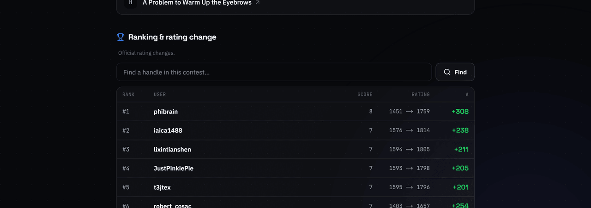
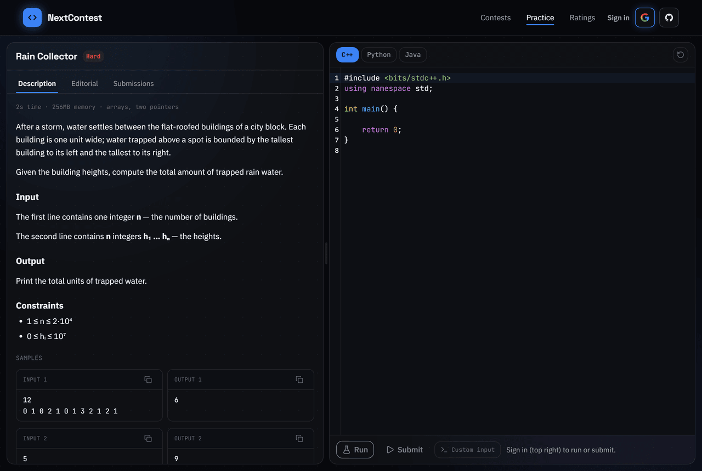

# NextContest

**Every upcoming Codeforces, LeetCode, AtCoder & CodeChef contest in one live feed** — with
email reminders, calendar sync, rating predictions, per-contest results, an online judge,
and 1v1 problem duels.

### 👉 [next-contest.vercel.app](https://next-contest.vercel.app)

[](https://next-contest.vercel.app)




---

## What it does

**📅 One feed for every platform** — Codeforces, LeetCode, AtCoder and CodeChef, synced every
30 minutes. Filter by platform, see live countdowns in your own timezone, and bookmark the
rounds you care about.

**🔔 Reminders that actually arrive** — email 24 hours and 1 hour before any contest you
bookmark. Auto-follow a platform and every new round is bookmarked for you.

**🗓️ Calendar sync** — add a single contest to Google Calendar, or subscribe to a personal
`.ics` feed that stays up to date on its own.

**🏆 Per-contest results** — every Codeforces and LeetCode round gets a page with the full
problem list and the complete standings, each row showing its rating change. Predicted
immediately after the round, swapped for the official delta once the platform rates it.



**📈 Rating predictions** — the Codeforces predictor is a TypeScript port of
[meooow25/carrot](https://github.com/meooow25/carrot) (FFT-seeded, O(n log n)); LeetCode uses
a self-hosted [lccn_predictor](https://github.com/baoliay2008/lccn_predictor). Look up any
handle on `/ratings` to see their contest history and rating timeline.

**⚔️ Problem duels** — challenge a friend to a 1v1 on random Codeforces problems neither of
you has solved. Timed, first-solve or race formats, with a shareable invite link.

**👤 Public profiles** — connect and verify handles across 7 platforms, then share
`/u/<username>`: solved counts, rating timeline, activity heatmap and streaks. Compare
head-to-head with a friend.

**⚖️ Practice judge** — original problems with an online judge of our own. Write C++, Python
or Java in the browser, run against the samples, and submit for an instant verdict.



---

## Stack

Next.js 16 (App Router, RSC) · TypeScript · tRPC v11 · Prisma 7 + PostgreSQL ·
Tailwind v4 + Base UI · Auth.js v5 (Google + GitHub) · nodemailer (Gmail SMTP) ·
CodeMirror 6 · three.js + React Three Fiber · next-themes.

The judge is a separate containerised microservice (Node + Hono, Docker sandboxes per
submission).

## Local development

```bash
# 1. Start a local Postgres (Docker)
docker compose up -d

# 2. Install deps + generate the Prisma client
npm install

# 3. Set up env
cp .env.example .env   # fill in the values (DATABASE_URL is preset for local Docker)

# 4. Migrate + seed
npx prisma migrate dev
npx tsx prisma/seed.ts   # optional: a few sample contests

# 5. Run
npm run dev
```

App runs at http://localhost:3000.

```bash
npm run typecheck   # tsc --noEmit
npm run lint        # eslint
npm run build       # production build
```

## Syncing contests

Contest data is pulled from each platform (Codeforces API, LeetCode GraphQL, CodeChef API,
AtCoder official-site scrape) by a secret-protected endpoint:

```bash
curl -H "Authorization: Bearer $CRON_SECRET" http://localhost:3000/api/cron/sync
```

In production this runs every 30 minutes via `.github/workflows/sync.yml`. Reminder emails go
out via `reminders.yml`, rating predictions via `predictions.yml`, and profile stats refresh
daily via `profiles.yml`.

> **Scheduling caveat.** GitHub Actions heavily throttles scheduled workflows — a declared
> 15-minute schedule here was measured running ~6x/day (average gap 5h, worst 8h). That is
> fine for the contest sync, but it used to skip the "starting soon" reminder entirely
> whenever no run landed inside its window. The dispatcher now uses a 2-hour window and the
> email states the true time remaining, but for reminders that actually land on time, point a
> reliable scheduler at the endpoint every ~5 minutes:
>
> ```
> GET  https://<your-app>/api/cron/reminders
> Header:  Authorization: Bearer <CRON_SECRET>
> ```
>
> Any free pinger works (cron-job.org, UptimeRobot, Upstash QStash). Vercel Cron on the
> Hobby plan is daily-only, so it is not an option here.

Each contest gets a stable, human-readable slug (`/contests/codeforces-round-1105-div-2`),
derived from its title and frozen once the contest starts so indexed URLs never move.

## Environment variables

See [`.env.example`](.env.example) for the full list — database, Auth.js, OAuth providers,
Gmail SMTP, cron secret, judge URL, and the optional Gemini and LeetCode-predictor endpoints.

## Deployment

- **DB:** Supabase / Neon (any standard Postgres `DATABASE_URL`).
- **App:** Vercel. Run `npx prisma migrate deploy` against the production DB once.
- **Cron:** GitHub Actions workflows (set repo secrets `APP_URL` and `CRON_SECRET`).
- **Judge:** any Docker host; point `JUDGE_URL` / `JUDGE_SECRET` at it.
